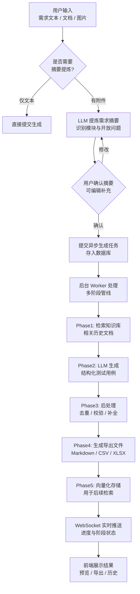

# AI Test Design Workbench

> 基于大语言模型的智能测试用例生成工作台，从需求、文档和图片中自动生成结构化测试用例。

---

## 项目简介

AI Test Design Workbench 是一个面向测试工程师的轻量级 Web 工具，通过接入大语言模型（LLM），将产品需求、参考文档和界面截图转化为结构化、可评审的测试用例。

适合的场景：
- 需求评审阶段快速生成测试大纲
- 历史缺陷/用例作为上下文，提升生成质量
- 支持 Markdown / CSV / Excel 导出，无缝接入现有测试流程

---

## 设计背景与价值

测试用例编写往往占用了大量重复性工时，尤其在需求变更频繁、业务复杂度高的项目中。人工编写的用例容易遗漏边界条件，且缺乏可追溯的历史知识沉淀。

本项目通过 LLM 自动生成 + 知识库 RAG 的方式：
- **提升效率**：输入需求即可获得覆盖正常/异常/边界的测试用例
- **保证一致性**：结构化输出（固定列）便于评审和修改
- **知识复用**：历史文档自动索引，后续生成时自动引用相关知识
- **多模态输入**：支持图片理解（UI 截图、架构图等）作为参考材料

---

## 核心功能架构

整体架构采用异步多阶段生成管线，确保可观测性与可控性。



### 功能模块

| 模块 | 说明 |
|------|------|
| 测试用例生成工作台 | 左侧输入需求与附件，右侧实时预览结果与进度 |
| 异步多阶段管线 | 通过 Celery Worker 后台执行，支持长时间生成任务 |
| 知识库 RAG | 上传/录入历史文档，自动分块与向量化，生成时检索引用 |
| 多模型支持 | 同时接入 OpenAI、DeepSeek、MiniMax 等模型，前端可切换 |
| 工具集 | 时间戳转换、JSON 格式化等日常调试工具 |
| 历史记录与导出 | 查看生成历史、重新加载结果、一键导出 Markdown/CSV/Excel |

---

## 技术栈

- **后端**：FastAPI + SQLAlchemy + Celery + Redis
- **前端**：React 19 + TypeScript + Vite + Ant Design
- **数据库**：PostgreSQL（生产）/ SQLite（开发）+ Redis（任务队列）
- **向量检索**（可选）：DashScope / OpenAI Embedding
- **模型接入**：OpenAI 兼容接口（支持多个供应商）

---

## 环境变量配置

从 `.env.example` 复制���份配置并填写真实值：

```bash
cp .env.example .env
```

### 基础配置

| 变量名 | 说明 |
|--------|------|
| `APP_NAME` | 应用名称 |
| `ENVIRONMENT` | 运行环境（development / production） |
| `DATABASE_URL` | 数据库连接串，开发可用 SQLite，生产推荐 PostgreSQL |

### LLM 模型配置（任选至少一个）

#### OpenAI
```bash
LLM_BASE_URL=https://api.openai.com/v1
LLM_API_KEY=sk-xxxxxxxx
LLM_MODEL=gpt-4o-mini
LLM_TEMPERATURE=0.2
LLM_MAX_TOKENS=128000
LLM_SUPPORTS_VISION=true
```

#### DeepSeek
```bash
DEEPSEEK_BASE_URL=https://api.deepseek.com/v1
DEEPSEEK_API_KEY=sk-xxxxxxxx
DEEPSEEK_MODEL=deepseek-reasoner
DEEPSEEK_MAX_OUTPUT_TOKENS=64000
DEEPSEEK_SUPPORTS_VISION=false
DEEPSEEK_SUPPORTS_STRUCTURED_OUTPUT=true
```

#### MiniMax
```bash
MINIMAX_BASE_URL=https://api.minimaxi.com/v1
MINIMAX_API_KEY=xxxxxxxx
MINIMAX_MODEL=MiniMax-M2.7-highspeed
MINIMAX_MAX_OUTPUT_TOKENS=131072
MINIMAX_SUPPORTS_VISION=false
MINIMAX_SUPPORTS_STRUCTURED_OUTPUT=false
```

> **注意**：前端模型列表仅显示已在后端配置 API Key 的供应商。若列表为空，请检查对应环境变量是否已正确设置。

### 上传与任务限制

| 变量名 | 默认值 | 说明 |
|--------|--------|------|
| `MAX_UPLOAD_SIZE_MB` | `10` | 单个文件最大大小（MB） |
| `MAX_DOCUMENT_CHARS_PER_FILE` | `8000` | 单个文档最大字符数 |
| `MAX_TOTAL_DOCUMENT_CHARS` | `20000` | 所有文档合计最大字符数 |
| `MAX_UPLOAD_FILES` | `6` | 最多同时上传文件数 |
| `GENERATION_MAX_RUNTIME_MINUTES` | `45` | 异步任务最大运行时长（超时自动标记失败） |

### 向量检索配置（可选）

若不配置，知识库仅使用标签/SQL 检索，不使用向量相似度。

**阿里云 DashScope 多模态 embedding**（推荐，支持图片）：
```bash
EMBEDDING_API_KEY=your_dashscope_api_key
EMBEDDING_MODEL=qwen3-vl-embedding
EMBEDDING_DIMENSIONS=2560
# 如需新加坡地域，额外配置：
# EMBEDDING_DASHSCOPE_MULTIMODAL_URL=https://dashscope.aliyuncs.com/api/v1/services/embeddings/multimodal
```

**OpenAI 兼容 embedding**：
```bash
EMBEDDING_BASE_URL=https://api.openai.com/v1
EMBEDDING_API_KEY=sk-xxxxxxxx
EMBEDDING_MODEL=text-embedding-3-small
EMBEDDING_DIMENSIONS=1536
```

---

## 本地开发指南

### 前提条件

- Python 3.12+
- Node.js 22+
- PostgreSQL 16（可选，开发可用 SQLite）

### 1. 克隆项目

```bash
git clone <your-repo-url>
cd case_hpr
```

### 2. 后端启动

```bash
cd backend

# 创建虚拟环境
python3 -m venv .venv
source .venv/bin/activate  # Windows 使用 .venv\Scripts\Activate.ps1

# 安装依赖
pip install -r requirements.txt

# 配置环境变量（在项目根目录 .env 文件已配置的前提下）
cd ..

# 启动开发服务器（热重载）
uvicorn app.main:app --app-dir backend --reload
```

后端默认运行在：http://localhost:8000

健康检查：http://localhost:8000/api/health

### 3. 前端启动

```bash
cd frontend
npm install
npm run dev
```

前端默认运行在：http://localhost:5173

> 开发模式下，Vite 会自动将 `/api` 请求代理到后端（8000 端口），避免跨域问题。

### 4. 初始化数据库

首次运行后端时会自动创建表结构。如需手动迁移：

```bash
cd backend
alembic revision --autogenerate -m "init"
alembic upgrade head
```

### 5. 配置模型 API Key

确保 `.env` 中至少配置了一个模型供应商的 API Key（参考上方环境变量配置）。后端启动时会读取可用模型列表，前端页面会自动显示。

---

## Docker Compose 部署

适合内网服务器单机一键部署。

### 步骤

```bash
# 1. 配置环境变量
cp .env.example .env
# 编辑 .env，填入真实的 LLM_API_KEY 等配置

# 2. 构建并启动
docker compose up --build -d

# 3. 查看日志
docker compose logs -f app
```

### 访问地址

- 应用界面：http://localhost:8000
- API 文档：http://localhost:8000/docs
- 健康检查：http://localhost:8000/api/health

### 数据持久化

- PostgreSQL 数据存储在 `postgres_data` Docker volume 中
- 如需备份，执行：`docker run --rm -v postgres_data:/data -v $(pwd):/backup alpine tar czf /backup/db-backup.tar.gz /data`

---

## 项目目录结构

```
case_hpr/
├── backend/
│   ├── app/
│   │   ├── api/          # 路由层（generate.py, knowledge.py）
│   │   ├── core/         # 配置与工具（config.py）
│   │   ├── db/           # 数据库会话与迁移
│   │   ├── models/       # SQLAlchemy ORM 模型
│   │   ├── prompts/      # Prompt 模板
│   │   ├── schemas/      # Pydantic 数据模型
│   │   ├── services/     # 业务逻辑层
│   │   │   ├── llm_client.py          # LLM 调用封装
│   │   │   ├── testcase_generator.py  # 核心生成逻辑
│   │   │   ├── generation_worker.py   # Celery 异步任务
│   │   │   ├── knowledge_service.py   # 知识库服务
│   │   │   └── testcase_exporter.py   # 导出功能
│   │   └── main.py       # FastAPI 应用入口
│   ├── tests/            # 单元/集成测试
│   └── requirements.txt  # Python 依赖
├── frontend/
│   ├── src/
│   │   ├── components/   # 通用组件
│   │   │   ├── AppLayout.tsx
│   │   │   ├── RequirementInput.tsx
│   │   │   ├── ResultPreview.tsx
│   │   │   ├── GenerationProgress.tsx
│   │   │   └── tools/    # 工具集组件
│   │   ├── pages/        # 页面级组件
│   │   │   ├── GeneratorPage.tsx    # 生成工作台
│   │   │   ├── KnowledgeListPage.tsx # 知识库列表
│   │   │   ├── KnowledgeDetailPage.tsx # 文档详情
│   │   │   └── ToolsPage.tsx        # 工具集
│   │   ├── services/     # API 调用封装（api.ts）
│   │   ├── context/      # React Context（生成任务状态）
│   │   └── styles/       # 全局样式
│   ├── package.json
│   └── vite.config.ts    # Vite 配置（含 /api 代理）
├── docker-compose.yml    # Docker 编排
├── Dockerfile            # 多阶段构建（前端 + 后端）
├── .env.example          # 环境变量示例
└── README.md             # 本文件
```

---

## 使用流程

### 快速开始

1. 打开浏览器访问 http://localhost:8000（或部署后的地址）
2. 在左侧「输入工作区」填写需求描述
3. 可选：上传参考文档（.txt, .md, .pdf, .docx）或图片（.png, .jpg 等）
4. 选择可用模型（下拉列表）
5. 点击「生成测试用例」按钮

### 生成流程

- **纯文本需求**：直接进入异步生成
- **含附件需求**：系统自动调用 LLM 提炼需求摘要，展示识别出的模块与待确认问题，你可编辑补充后确认提交

生成过程中：
- 右侧工作区实时显示当前阶段（Phase1~Phase5）与进度条
- 可通过 WebSocket 实时推送，支持取消任务
- 完成后展示结构化表格与 Markdown 渲染结果

### 知识库使用

访问「知识库」标签页：

1. **上传文档**：支持 .txt, .md, .pdf, .docx，可填写标题、类型、模块标签
2. **手动录入**：直接粘贴文本内容，设置元数据
3. **文档详情**：点击列表行的「详情」查看内容、分块与向量化状态
4. **重建索引**：修改文档后点击「索引」重新向量化
5. **生成时自动检索**：生成测试用例时，系统自动检索相关知识并注入 Prompt

### 导出结果

在结果工作区点击导出按钮，支持三种格式：
- **Markdown**（.md）：可直接粘贴到 Confluence / 飞书文档，或者导入Xmind
- **CSV**（.csv）：导入 Excel / 测试管理工具
- **Excel**（.xlsx）：保留多 sheet，含用例表与统计摘要

---

## API 接口速览

### 生成相关

| 方法 | 路径 | 说明 |
|------|------|------|
| POST | `/api/v1/generate` | 同步生成（建议仅用于调试） |
| POST | `/api/v1/generate/async` | 异步提交任务 |
| GET | `/api/v1/generate/tasks/{taskId}` | 查询任务状态 |
| POST | `/api/v1/generate/tasks/{taskId}/cancel` | 取消任务 |
| GET | `/api/v1/generate/tasks` | 分页查询历史任务 |
| DELETE | `/api/v1/generate/tasks` | 清空全部历史 |
| POST | `/api/v1/generate/review` | 需求评审（提炼摘要） |
| GET | `/api/v1/generations/{generationId}/export` | 导出结果 |

### 知识库相关

| 方法 | 路径 | 说明 |
|------|------|------|
| GET | `/api/v1/knowledge/documents` | 分页查询文档 |
| POST | `/api/v1/knowledge/documents` | 手动创建文档 |
| POST | `/api/v1/knowledge/documents/upload` | 上传文件 |
| GET | `/api/v1/knowledge/documents/{id}` | 查询文档详情 |
| PUT | `/api/v1/knowledge/documents/{id}` | 更新文档 |
| DELETE | `/api/v1/knowledge/documents/{id}` | 删除文档 |
| POST | `/api/v1/knowledge/documents/{id}/reindex` | 重建向量索引 |
| POST | `/api/v1/knowledge/search` | 语义检索 |
| GET | `/api/v1/knowledge/stats` | 统计信息 |

### 模型管理

| 方法 | 路径 | 说明 |
|------|------|------|
| GET | `/api/v1/models` | 获取可用模型列表（仅返回已配置 API Key 的供应商） |

---

## 支持的文件格式

| 类型 | 格式 | 说明 |
|------|------|------|
| 参考文档 | `.txt`, `.md`, `.pdf`, `.docx` | 自动解析文本内容，PDF 扫描版效果有限 |
| 参考图片 | `.png`, `.jpg`, `.jpeg`, `.webp` | 需模型支持视觉能力（`supportsVision=true`） |
| 导出结果 | `.md`, `.csv`, `.xlsx` | 一键下载，含用例表与元数据 |

---

## Prompt 设计

系统 Prompt 定义在 `backend/app/prompts/testcase_prompt.py`，将 LLM 角色固定为资深测试工程师，并约束输出格式：

- 仅输出 Markdown 表格（或 JSON 结构化数据供后处理）
- 固定列：`用例ID`、`测试标题`、`前置条件`、`测试步骤`、`预期结果`
- 额外字段：`category`（类别）、`priority`（优先级）、`module`（模块）、`confirmationNote`（需确认项）
- 要求覆盖：正常流程、异常流程、边界条件、输入校验

Prompt 会动态注入知识库检索到的相关文档片段，提升生成的相关性与准确性。

---

## 已知限制与未来规划

### 当前限制

- **PDF 文本提取**：扫描版 PDF 无法提取文本，建议先转换为 .txt 或 .md
- **图片理解**：依赖所选模型的视觉能力；若模型不支持，请勿上传图片或切换模型
- **生成时长**：复杂需求可能耗时 1~5 分钟，已配置 45 分钟超时自动失败
- **上下文长度**：受模型最大输入 token 限制，超大文档会被截断（有告警）
- **会话无状态**：每次生成独立，不保留历史对话上下文

### 后续迭代方向

- [ ] 会话模式：多轮交互式用例完善
- [ ] 用例评审：支持人工标注反馈，形成微调数据集
- [ ] 更多导出格式：TestLink / Jira / 禅道
- [ ] 团队协作：用例共享、权限管理、变更历史
- [ ] 更多模型接入：Claude、Gemini、国内厂商
- [ ] 自动化测试集成：一键生成 pytest / Playwright 脚本框架

---

## 开源协议

MIT License。详见 [LICENSE](LICENSE) 文件。

---

## 贡献与反馈

欢迎提 Issue 与 PR。如果你是技术大牛，对架构设计、Prompt 工程、RAG 优化有见解，欢迎交流！

**项目地址**：https://gitee.com/kyleoo/case-agent

---

> 最后更新：2026-04-16
> 当前版本：v0.1.0
